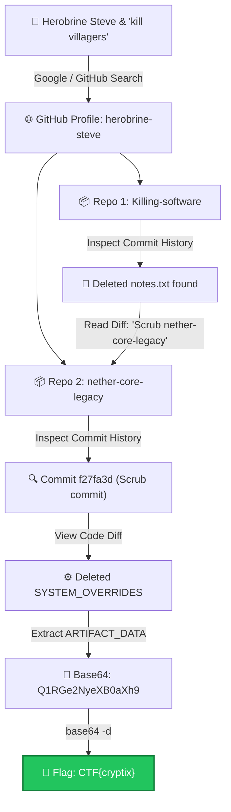

# The Ghost in the Blocks — Cytech CTF Write-Up

<div align="center">


</div>

---

## 📋 Challenge Information

| Field | Detail |
| :--- | :--- |
| **Challenge Name** | The Ghost in the Blocks |
| **Category** | OSINT / Git Forensics |
| **Difficulty** | Easy / Medium |
| **Flag** | `CTF{cryptix}` |

---

## 🎯 Challenge Description & Objective

The challenge mentions an elusive actor named **"Herobrine Steve"** who authored a script to **"kill villagers"** in Minecraft and attempted to scrub his older tracks from the web.

> **Objective:** Track down Herobrine Steve's online presence, audit his Git repositories and commit logs, recover scrubbed configuration artifacts, and retrieve the hidden flag.

---

## 🗺️ Investigation Flow



---

## 🔍 Step-by-Step Walkthrough & Commands

### 1. OSINT: Finding the GitHub Profile

The challenge hints at **Herobrine Steve** and a script to **"kill villagers"**.

**Search Queries:**
```text
"Herobrine Steve"
"herobrine-steve kill villagers"
```

**Target Identified:**
* GitHub Profile: [https://github.com/herobrine-steve](https://github.com/herobrine-steve)

On the profile, two repositories were found:
1. `Killing-software` — The villager script
2. `nether-core-legacy` — An old project he was trying to delete

---

### 2. Checking `Killing-software`

Cloning and checking commit history:

```bash
# Clone the repository locally
git clone https://github.com/herobrine-steve/Killing-software.git
cd Killing-software

# View commit history
git log --oneline
```

Or directly via GitHub:
* Commits: [https://github.com/herobrine-steve/Killing-software/commits/main/](https://github.com/herobrine-steve/Killing-software/commits/main/)

Going through the commits revealed an old file `notes.txt`. The file was deleted in a later commit, but remained completely preserved in Git history.

To inspect the deleted file from the terminal:
```bash
# Find commits modifying notes.txt
git log --all --full-history -- "notes.txt"

# View the diff of the commit where notes.txt was modified/deleted
git show HEAD~1:notes.txt
```

**Inside `notes.txt`:**
```text
The old 'nether-core-legacy' project has some leftover artifacts in the logs.
Need to scrub that repository completely before anyone starts digging.
```

> [!NOTE]
> This note serves as a direct pivot telling us exactly where to look next: `nether-core-legacy`.

---

### 3. Investigating `nether-core-legacy`

Navigating to the target repository:
* Repo: [https://github.com/herobrine-steve/nether-core-legacy](https://github.com/herobrine-steve/nether-core-legacy)
* Commits: [https://github.com/herobrine-steve/nether-core-legacy/commits/main/](https://github.com/herobrine-steve/nether-core-legacy/commits/main/)

Cloning and checking history locally:
```bash
cd ..
git clone https://github.com/herobrine-steve/nether-core-legacy.git
cd nether-core-legacy

# Inspect commit logs with diffs
git log -p
```

Looking for anything scrubbed/deleted led directly to commit:
* **Commit Hash:** `f27fa3dbd43fe5791bb14b2e1e9c01bfcd0ee5e5`
* **Commit URL:** [https://github.com/herobrine-steve/nether-core-legacy/commit/f27fa3dbd43fe5791bb14b2e1e9c01bfcd0ee5e5](https://github.com/herobrine-steve/nether-core-legacy/commit/f27fa3dbd43fe5791bb14b2e1e9c01bfcd0ee5e5)

Viewing the commit diff:
```bash
git show f27fa3dbd43fe5791bb14b2e1e9c01bfcd0ee5e5
```

**Diff Output Snippet:**
```diff
- const SYSTEM_OVERRIDES = {
-   DEBUG_MODE: false,
-   ARTIFACT_DATA: "Q1RGe2NyeXB0aXh9"
- };
```

Found deleted JS config block `SYSTEM_OVERRIDES` containing:
```javascript
ARTIFACT_DATA : "Q1RGe2NyeXB0aXh9"
```

This is standard Base64.

---

### 4. Decoding the Payload

Decoding the Base64 string directly in terminal:

```bash
echo "Q1RGe2NyeXB0aXh9" | base64 -d
```

**Output:**
```text
CTF{cryptix}
```

---

## 🚩 Flag

```text
CTF{cryptix}
```

---

## 💡 Key Takeaways & Lessons Learned

> [!IMPORTANT]
> **Deleting stuff from Git $\neq$ actually deleting it.**  
> Git is an immutable directed acyclic graph (DAG) of commits. When a developer deletes a file or config using `git rm` or simply commits a file removal, the data is **not removed** — only the current tree pointer changes. The old commits, diffs, and trees remain in the history forever unless the commit history is completely rewritten (e.g., using `git filter-repo` or BFG) and force-pushed.
