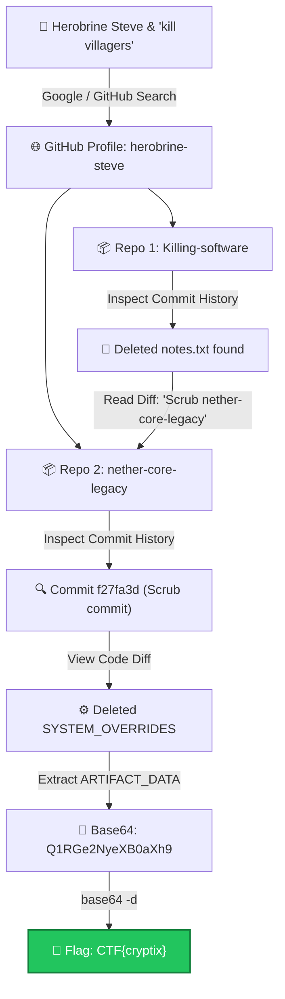

# The Ghost in the Blocks — Cryptix CTF Write-Up

> **Event:** Cryptix CTF — Organized by **HTU Cyber Club** in collaboration with **CYS-TECH**

> [!NOTE]
> Part of the [**Cyrptix CTF OSINT Write-Ups Collection**](https://github.com/Dabuynyx/Cyrptix-CTF-OSINT-write-up).

<div align="center">


</div>

---

## 📋 Challenge Information

| Field | Detail |
| :--- | :--- |
| **Challenge Name** | The Ghost in the Blocks |
| **Category** | OSINT with DFIR (Git Forensics) |
| **Target Identity** | `Herobrine Steve` (`herobrine-steve`) |
| **Associated Repositories** | `Killing-software`, `nether-core-legacy` |
| **Final Flag** | `CTF{cryptix}` |

---

## 🎯 Threat Scenario & Objective

Cyber intelligence analysts intercepted chatter regarding a threat actor going by the pseudonym **"Herobrine Steve"** operating in blocky sandbox gaming platforms. The actor boasted about publishing an automation script designed to **"kill villagers"** and mentioned attempting to scrub an older, classified project repository from public sight.

> **Objective:** Track down Herobrine Steve's online presence, audit his Git repositories and historical commit logs, discover developer notes left in deleted files, recover scrubbed configuration artifacts, and decode the hidden flag.

---

## 🗺️ Investigation Flowchart



---

## 🔍 Step-by-Step Walkthrough & Forensic Analysis

### 1. OSINT: Locating the Threat Actor Profile

The prompt hints at **Herobrine Steve** and a script to **"kill villagers"**.

**Search Queries:**
```text
"Herobrine Steve"
"herobrine-steve kill villagers"
```

**Target Identified:**
* Profile URL: [https://github.com/herobrine-steve](https://github.com/herobrine-steve)

Auditing the public profile revealed two repositories:
1. `Killing-software` — The villager script mentioned in intelligence chatter.
2. `nether-core-legacy` — An older project marked for disposal.

---

### 2. Forensic Analysis of `Killing-software`

Cloning and checking commit history:

```bash
# Clone the repository locally
git clone https://github.com/herobrine-steve/Killing-software.git
cd Killing-software

# Inspect chronological commit history with stats
git log --oneline --stat
```

Going through the commits:
* Commits: [https://github.com/herobrine-steve/Killing-software/commits/main/](https://github.com/herobrine-steve/Killing-software/commits/main/)

Reviewing the commit history revealed that a file named `notes.txt` was added and subsequently deleted. 

To inspect deleted files across the entire commit graph from the terminal:
```bash
# Query the commit history specifically tracking notes.txt
git log --all --full-history -- "notes.txt"

# Show the file content directly from the commit prior to deletion
git show HEAD~1:notes.txt
```

**Inside `notes.txt`:**
```text
The old 'nether-core-legacy' project has some leftover artifacts in the logs.
Need to scrub that repository completely before anyone starts digging.
```

> [!NOTE]
> The author inadvertently documented his cleanup intentions in Git, providing a direct pivot to `nether-core-legacy`.

---

### 3. Digging into `nether-core-legacy`

Navigating to the target repository:
* Repo: [https://github.com/herobrine-steve/nether-core-legacy](https://github.com/herobrine-steve/nether-core-legacy)
* Commits: [https://github.com/herobrine-steve/nether-core-legacy/commits/main/](https://github.com/herobrine-steve/nether-core-legacy/commits/main/)

```bash
cd ..
git clone https://github.com/herobrine-steve/nether-core-legacy.git
cd nether-core-legacy

# Inspect full patch diffs of all commits
git log -p
```

Searching for commits that scrubbed configuration data or removed files:
* **Scrub Commit Hash:** `f27fa3dbd43fe5791bb14b2e1e9c01bfcd0ee5e5`
* **Commit Link:** [https://github.com/herobrine-steve/nether-core-legacy/commit/f27fa3dbd43fe5791bb14b2e1e9c01bfcd0ee5e5](https://github.com/herobrine-steve/nether-core-legacy/commit/f27fa3dbd43fe5791bb14b2e1e9c01bfcd0ee5e5)

Viewing the unified diff of the commit:
```bash
git show f27fa3dbd43fe5791bb14b2e1e9c01bfcd0ee5e5
```

**Unified Diff Snippet:**
```diff
commit f27fa3dbd43fe5791bb14b2e1e9c01bfcd0ee5e5
Author: Herobrine Steve <steve@nethercore.local>
Date:   Wed Apr 15 2026 14:10:22 +0000

    refactor: remove deprecated overrides and clean config

--- a/config/core.js
+++ b/config/core.js
@@ -12,8 +12,4 @@
-const SYSTEM_OVERRIDES = {
-  DEBUG_MODE: false,
-  ARTIFACT_DATA: "Q1RGe2NyeXB0aXh9"
-};
```

Found deleted JavaScript configuration block `SYSTEM_OVERRIDES` containing:
```javascript
ARTIFACT_DATA : "Q1RGe2NyeXB0aXh9"
```

---

### 4. Decoding the Payload

The extracted string `Q1RGe2NyeXB0aXh9` is Base64 encoded (16 characters, valid 4-byte block alignment).

Decoding execution:

```bash
echo "Q1RGe2NyeXB0aXh9" | base64 -d
```

**Decoded Output:**
```text
CTF{cryptix}
```

---

## 🚩 Final Flag

```text
CTF{cryptix}
```

---

## 💡 Summary & Key Takeaways

```text
Herobrine Steve
└── Killing-software
    └── Commit history
        └── Deleted notes.txt (Pivot lead)
            └── nether-core-legacy
                └── Scrub commit (f27fa3dbd43fe5791bb14b2e1e9c01bfcd0ee5e5)
                    └── SYSTEM_OVERRIDES.ARTIFACT_DATA: "Q1RGe2NyeXB0aXh9"
                        └── Base64 decode
                            └── CTF{cryptix}
```

> [!IMPORTANT]
> **Git Forensics Principle:** Deleting files or altering source code in a modern Version Control System (VCS) like Git does not remove historical records unless the commit graph is actively rewritten (e.g., using `git filter-repo` or BFG Repo-Cleaner) and force-pushed. Even if a developer scrubs credentials in a subsequent commit, previous commits remain accessible.


---

## ⚖️ Legal Policy & Educational Disclaimer

> [!IMPORTANT]
> **Educational & Authorized Research Purpose Only.**  
> All materials, intelligence disclosures, and technical methodologies documented in this repository are for educational, Capture The Flag (CTF) research, and authorized digital forensics training purposes only.
>
> The author strictly condemns and prohibits unauthorized computer access or malicious activities. Any testing or execution of these techniques outside consensual, authorized environments is strictly prohibited.
> 
> For complete terms, non-liability clauses, and international cyber law compliance disclosures, see the official [**Legal Policy & Disclaimer (DISCLAIMER.md)**](DISCLAIMER.md).

---

## 📄 License

This project is licensed under the [MIT License](LICENSE) — see the [LICENSE](LICENSE) file for details.
